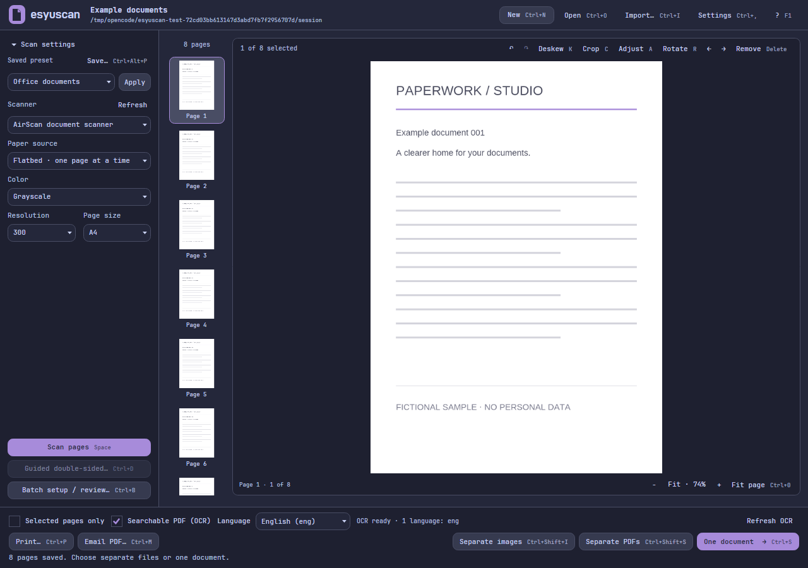

# esyuscan

A small document-scanning workspace that follows your Omarchy theme.

**Vibecoded with AI for my personal use.** Experimental software, provided as-is;
keep backups of important documents. Support and compatibility are not guaranteed.

Built for my **2021 M1 Pro MacBook Pro running Omarchy (Arch Linux ARM +
Hyprland)**, not native macOS. The GUI requires Wayland. Linux x86_64 packaging
is included but has not been hardware-tested by me.

## A look inside



Scan through AirScan/eSCL or SANE, review and edit pages, then export individual
images, separate PDFs or one document. Optional OCR uses an installed Tesseract.
The scanning and document backend is the unmodified NAPS2 SDK.

The screenshot uses generated demo pages, not private documents or scanner IDs.

## Build and run

Requires the .NET 10 SDK and native dependencies in [PKGBUILD](pkgbuild/PKGBUILD).

```sh
dotnet restore Scan.slnx --locked-mode
make build
make run
```

`make package` builds an Arch package; `make install` installs it with authorization.
The installed command is `esyuscan`; internal solution and project files use
`Scan`. See the [usage guide](docs/usage.md) and
[scanner setup](docs/scanners.md) for supported workflows and hardware limits.

## Development and contributions

```sh
make format
make check       # fast checks
make check-all   # full tests and dependency audit
```

Tests use generated documents and fake devices; they do not start physical scans
or print jobs. Fork the repo, make a focused branch, and open a pull request with
a short explanation, checks run, and screenshots for UI changes. Issues and PRs
are welcome, but this remains a personal project. Never include credentials,
private documents or real device addresses in reports or fixtures.

Printing companion: [esyuprint](https://github.com/AyeCaptn/esyuprint).

MIT for the app's original code. See [LICENSE](LICENSE) and
[upstream notices](THIRD-PARTY.md) for dependency licenses.
